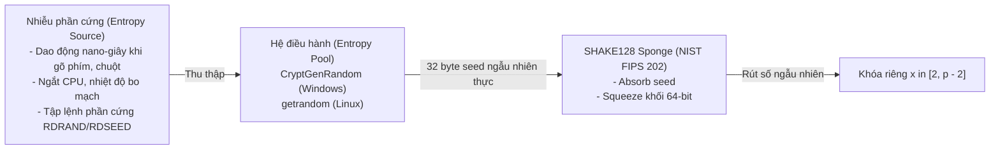
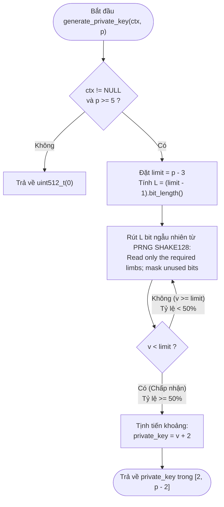

# Module Sinh Khóa Riêng Cho Trao Đổi Khóa Diffie–Hellman

Tài liệu này mô tả module `prng_sample/src/private_key.cpp` và các khai báo trong `prng_sample/src/dh_sample.h`.
Nội dung kiểm thử lịch sử bên dưới được cập nhật bởi `generate_private_key.md`:
bộ test chính kiểm tra tái lập/ranh giới limb, bộ mở rộng kiểm tra thống kê và DH 512 bit.

---

## 1. API và Hợp Đồng Đầu Vào / Đầu Ra

### `uint512_t generate_private_key(prng_ctx *ctx, const uint512_t &p)`

Hàm sinh khóa riêng ngẫu nhiên nhận con trỏ ngữ cảnh PRNG (phục vụ kiểm thử tái lập và kiểm soát luồng ngẫu nhiên).

- **Đầu vào `ctx`:**
  - Con trỏ ngữ cảnh PRNG SHAKE128 đã được khởi tạo bằng `prng_seed`.
  - Phải khác `NULL`. Nếu `ctx == NULL`, hàm trả về `uint512_t(0)`.
- **Đầu vào `p`:**
  - Số nguyên lớn modulus của nhóm Diffie–Hellman (thường là safe prime 512 bit trở lên).
  - Điều kiện hợp lệ: $p \ge 5$. Hàm trả về `uint512_t(0)` nếu $p < 5$; p=4 không phải modulus nguyên tố hợp lệ cho hợp đồng này.
- **Đầu ra:**
  - Một số nguyên lớn `uint512_t` được chọn ngẫu nhiên phân phối đều trong đoạn $[2, p - 2]$.
  - Trả về `uint512_t(0)` nếu bất kỳ tham số đầu vào nào không hợp lệ.

---

### `uint512_t generate_private_key(const uint512_t &p)`

Hàm tiện ích nạp chồng (overload), cho phép gọi trực tiếp `generate_private_key(p)` đúng theo cú pháp hàm `main` mẫu của đề bài Lab01.

- **Đầu vào `p`:**
  - Số nguyên lớn modulus, yêu cầu $p \ge 5$.
- **Đầu ra:**
  - Một số nguyên lớn `uint512_t` ngẫu nhiên đều trong đoạn $[2, p - 2]$. Trả về `uint512_t(0)` nếu $p < 5$.
- **Cơ chế:**
  - Tự động gọi `randombytes()` để trích xuất 32 byte (256 bit) entropy bảo mật từ hệ điều hành (`CryptGenRandom` trên Windows hoặc `getrandom` trên Linux).
  - Khởi tạo ngữ cảnh PRNG SHAKE128 cục bộ rồi gọi `generate_private_key(&ctx, p)`. Mỗi lần gọi sinh ra một khóa riêng độc lập hoàn toàn.

---

## 2. Tính Ngẫu Nhiên và Tầm Quan Trọng Trong Mật Mã Học

### 2.1. Bản chất của tính ngẫu nhiên
Trong mật mã học, một giá trị hoặc chuỗi bit được coi là ngẫu nhiên khi thỏa mãn hai tính chất cốt lõi:
1. **Không thể dự đoán (Unpredictability):** Kẻ tấn công dù biết mọi giá trị đã sinh ra trước đó cũng không thể đoán được bit tiếp theo với xác suất $> 50\%$.
2. **Tính phân phối đều (Uniform Distribution):** Mọi giá trị trong không gian mẫu đều có xác suất xuất hiện hoàn toàn bằng nhau, không bị thiên lệch (bias) về bất kỳ số nào.

### 2.2. Tầm quan trọng trong Diffie–Hellman
Hệ thống mật mã hiện đại tuân theo nguyên lý Kerckhoffs: *"Độ an toàn phụ thuộc vào việc giữ bí mật khóa, không phụ thuộc vào việc giấu thuật toán"*.
- Trong trao đổi khóa Diffie–Hellman, nếu số ngẫu nhiên bị lỗi hoặc suy giảm entropy, kẻ tấn công có thể thu hẹp không gian tìm kiếm và đoán được khóa riêng $a$ hoặc $b$.
- Khi biết $a$, kẻ tấn công lập tức tính được bí mật chung $s = B^a \bmod p$ và giải mã toàn bộ thông điệp mà không cần giải bài toán logarit rời rạc khó khăn.

### 2.3. Phân biệt PRNG thông thường và PRNG an toàn mật mã (CSPRNG)
| Tiêu chí | PRNG thông thường (ví dụ: `rand()`, `mt19937`) | CSPRNG (Bộ sinh an toàn mật mã) |
| :--- | :--- | :--- |
| **Mục đích** | Mô phỏng, trò chơi điện tử, thống kê. | Sinh khóa bí mật, số nonce, IV, sinh số nguyên tố. |
| **Tốc độ** | Rất nhanh. | Chậm hơn đôi chút do phải qua hàm băm/hoán vị mật mã. |
| **Tính dự đoán** | **Dễ bị giải ngược.** Quan sát vài số đầu ra là khôi phục được trạng thái nội bộ. | **Không thể giải ngược.** Kháng truy ngược trạng thái cũ (Backtracking resistance) và kháng dự đoán tương lai (Prediction resistance). |

---

## 3. Cách Tạo Hàm Sinh Số Ngẫu Nhiên An Toàn Trên Máy Tính

Máy tính là thiết bị tất định (deterministic), do đó không thể tự sinh ra tính ngẫu nhiên thực sự nếu chỉ dùng các hàm toán học thuần túy. Để tạo một CSPRNG an toàn, hệ thống kết hợp 2 giai đoạn:



1. **Thu thập Entropy từ thế giới vật lý:** Hệ điều hành gom các hiện tượng hỗn loạn ngoài đời thực (dao động nano-giây giữa các phím gõ, di chuột, độ trễ ngắt đĩa cứng, tập lệnh phần cứng `RDRAND` trên CPU). Khi ứng dụng cần, nó gọi API hệ điều hành (`CryptGenRandom` trên Windows hoặc `getrandom` trên Linux) để nhận 32 byte seed ngẫu nhiên thực.
2. **Khuếch đại ngẫu nhiên qua hàm Sponge (SHAKE128):** Sử dụng 32 byte seed để khởi tạo trạng thái Keccak 1600 bit (`shake128_absorb`). Sau đó, mỗi khi cần số ngẫu nhiên, ta "vắt" (`shake128_squeeze`) ra các khối dữ liệu 64 bit (`prng_next_u64`). Cơ chế băm mật mã một chiều đảm bảo không ai có thể đoán trước số kế tiếp hoặc truy ngược lại seed ban đầu.

---

## 4. Cơ Sở Thuật Toán và Cơ Chế Hoạt Động Của `generate_private_key`

### 4.1. Cấu trúc không gian khóa
Khóa riêng $x$ phải nằm trong khoảng $[2, p - 2]$:
- Giá trị 0 và 1 bị loại bỏ vì $g^0 \equiv 1$ và $g^1 \equiv g \pmod p$ làm lộ bí mật.
- Giá trị $p - 1$ bị loại bỏ vì $g^{p-1} \equiv 1 \pmod p$ (theo định lý Fermat nhỏ).
- Tổng số phần tử hợp lệ: $\text{limit} = (p - 2) - 2 + 1 = p - 3$.

### 4.2. Cạm bẫy Modulo Bias và Giải pháp Rejection Sampling
Một sai lầm phổ biến là lấy số ngẫu nhiên lớn $R$ rồi chia lấy dư:
$$x = (R \bmod (p - 3)) + 2$$
Vì không gian sinh $2^L$ không chia hết cho $(p - 3)$, các số dư nhỏ hơn $2^L \bmod (p - 3)$ sẽ có xác suất xuất hiện cao hơn. Sự chênh lệch xác suất này (**Modulo Bias**) làm rò rỉ thông tin khóa riêng.

Để loại bỏ hoàn toàn độ lệch modulo, thuật toán áp dụng chuẩn **NIST FIPS 186-5** (Phụ lục A.1.2) bằng phương pháp **Bốc mẫu từ chối đều (Uniform Rejection Sampling)**:



1. **Bước 1:** Kiểm tra hợp lệ (`ctx != NULL` và $p \ge 5$). Nếu sai, trả về 0.
2. **Bước 2:** Đặt $\text{limit} = p - 3$. Đo chiều dài bit cần thiết: $L = \text{(limit - 1).bit\_length()}$.
3. **Bước 3:** Rút $L$ bit ngẫu nhiên từ SHAKE128 để được số $v \in [0, 2^L - 1]$ thông qua hàm `random_bits`.
4. **Bước 4 (Từ chối / Chấp nhận):**
   - Nếu $v < \text{limit}$: Chấp nhận $v$.
   - Nếu $v \ge \text{limit}$: Bỏ qua và lặp lại Bước 3.
5. **Bước 5 (Tịnh tiến):** Tính $\text{private\_key} = v + 2$.
   - Khi $v = 0 \implies \text{private\_key} = 2$.
   - Khi $v = p - 4 \implies \text{private\_key} = p - 2$.
   - Mọi giá trị trong $[2, p - 2]$ đều có xác suất xuất hiện bằng nhau tuyệt đối: $P = \frac{1}{p - 3}$.

Do $2^{L-1} < \text{limit} \le 2^L$, xác suất chấp nhận mỗi lần rút luôn đạt $P_{\text{accept}} \ge 50\%$. Số lần lặp kỳ vọng $E[N] < 2$, thuật toán kết thúc rất nhanh.

---

## 5. Kết Quả Kiểm Thử (Test Cases & Verification)

Bộ kiểm thử chính ở `src/test_private_key.cpp`; các ca thống kê/512 bit bên dưới
ở `src/test_private_key_extended.cpp`. Kết quả thống kê dưới đây là log lịch sử
của thuật toán cũ, không đại diện chuỗi PRNG sau khi đổi cách lấy số limb.

1. **Kiểm tra tham số không hợp lệ:**
   - `ctx == NULL` $\rightarrow$ trả về 0 (Đạt).
   - $p \in \{0, 1, 2, 3, 4\}$ ($p < 5$) $\rightarrow$ trả về 0 (Đạt).
2. **Kiểm tra biên số nhỏ:**
   - $p = 4$ bị từ chối, trả về 0 vì hợp đồng yêu cầu $p \ge 5$.
   - $p = 5$ (khoảng $[2, 3]$) $\rightarrow$ chỉ xuất hiện 2 và 3 (Đạt).
   - $p = 7$ (khoảng $[2, 5]$) $\rightarrow$ bao phủ đủ cả 4 giá trị $\{2, 3, 4, 5\}$ (Đạt).
3. **Kiểm tra tính phân phối đều (Thực nghiệm loại bỏ Modulo Bias):**
   Thực hiện sinh $N = 20,000$ mẫu cho $p = 7$ (khoảng $[2, 5]$, xác suất lý thuyết mỗi số là $25\%$ = 5,000 lần):
   - Số 2: 5,034 lần ($25.17\%$)
   - Số 3: 4,975 lần ($24.88\%$)
   - Số 4: 4,984 lần ($24.92\%$)
   - Số 5: 5,007 lần ($25.04\%$)
   $\rightarrow$ Các tần suất nằm trong ngưỡng kiểm tra; mẫu hữu hạn không chứng minh phân phối đều tuyệt đối.
4. **Kiểm tra với Safe Prime 512 bit:**
   - Sinh khóa riêng Alice: $a \in [2, p - 2]$ (511 bits).
   - Sinh khóa riêng Bob: $b \in [2, p - 2]$ (506 bits).
   - Hai khóa cố định trong ca này khác nhau; hai lần lấy mẫu độc lập vẫn có thể trùng, không bắt buộc $a \neq b$.
5. **Mô phỏng trao đổi khóa Diffie–Hellman hoàn chỉnh:**
   - Alice tính: $A = g^a \bmod p$
   - Bob tính: $B = g^b \bmod p$
   - Bí mật chung Alice tính: $s_{\text{Alice}} = B^a \bmod p$
   - Bí mật chung Bob tính: $s_{\text{Bob}} = A^b \bmod p$
   $\rightarrow$ Xác nhận $s_{\text{Alice}} == s_{\text{Bob}}$ (hai bên tính ra cùng một giá trị bí mật chung 512 bit).

---

## 6. Các Lỗi Phát Hiện Khi Test và Cách Khắc Phục

1. **Lỗi tràn mảng khi $bits = 512$:**
   Chỉ mask limb cuối khi `bits % 64 != 0`; do đó khi bits=512 không truy cập digits[8]. Ca biên đã có trong test chính.
2. **Lỗi tràn dưới (Underflow) khi $p < 5$:**
   Guard hiện tại là `if (ctx == NULL || p < uint512_t(5)) return uint512_t(0);`, trước khi tính range. Phép p−3 có thể tràn nếu p<3; p=3 có khoảng rỗng, p=4 không đạt hợp đồng modulus nguyên tố.
3. **Lỗi liên kết Linker trên Windows:**
   Khi sử dụng `CryptGenRandom`, trình biên dịch cần liên kết thư viện hệ thống Windows `-ladvapi32`. Đã cập nhật vào `Makefile` để build tự động mượt mà.

---

## 7. Hướng Dẫn Biên Dịch và Chạy Kiểm Thử

### Lệnh chạy nhanh trên Windows (PowerShell):
```powershell
cd prng_sample
g++ -std=c++14 -O3 -Wall -Wextra -Wpedantic src/test_private_key_extended.cpp src/private_key.cpp src/dh_sample.cpp src/u512_sample.cpp lib/fips202/prng.cpp lib/fips202/fips202.c -I src -I lib/fips202 -ladvapi32 -o bin/test-private-key.exe
.\bin\test-private-key.exe
```

### Lệnh chạy trên Linux / WSL qua Makefile:
```sh
cd prng_sample
make test-private-key
./bin/test-private-key
```

---

## 8. Tài Liệu Tham Khảo

1. NIST, [FIPS 186-5: Digital Signature Standard (DSS)](https://nvlpubs.nist.gov/nistpubs/FIPS/NIST.FIPS.186-5.pdf) — Phụ lục A.1.2 về sinh số ngẫu nhiên đều trong khoảng và bốc mẫu từ chối.
2. NIST, [FIPS 202: SHA-3 Standard: Permutation-Based Hash and Extendable-Output Functions](https://nvlpubs.nist.gov/nistpubs/FIPS/NIST.FIPS.202.pdf) — Định nghĩa cơ chế Sponge và XOF SHAKE128.
3. NIST, [SP 800-90A Rev. 1: Recommendation for Random Number Generation Using Deterministic Random Bit Generators](https://csrc.nist.gov/pubs/sp/800/90/a/r1/final).
4. IETF, [RFC 3526: More Modular Exponential (MODP) Diffie-Hellman groups for Internet Key Exchange (IKE)](https://datatracker.ietf.org/doc/html/rfc3526).
5. IETF, [RFC 2631: Diffie-Hellman Key Agreement Method](https://datatracker.ietf.org/doc/html/rfc2631).
